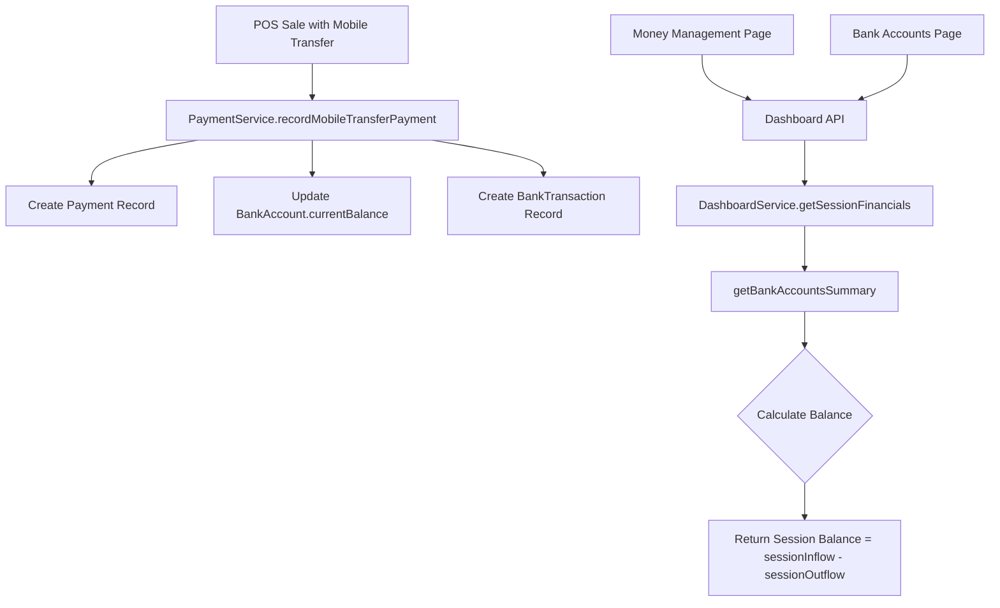

# Design Document: Bank Account Session Balance

## Overview

This design addresses the issue where bank account balances on the Money Management and Bank Accounts pages display cumulative all-time balances instead of session-specific balances. The solution modifies the `DashboardService.getBankAccountsSummary()` method to return session-calculated balances and updates the frontend components to properly display these session-aware values.

## Architecture

The current architecture already has the correct data flow:
1. Sales with mobile transfer payments create `Payment` records with `bankAccountId`
2. `BankTransaction` records are created for each payment
3. `DashboardService.getSessionFinancials()` returns bank account data to the frontend

The issue is in the balance calculation - the service returns `currentBalance` (cumulative) instead of calculating session-specific balance from `BankTransaction` records.



## Components and Interfaces

### Modified Components

#### 1. DashboardService.getBankAccountsSummary()

**Current Behavior**: Returns `currentBalance` from database (cumulative all-time balance)

**New Behavior**: Returns `sessionBalance` calculated as `sessionInflow - sessionOutflow`

```typescript
interface BankAccountSummary {
  id: string;
  bankName: string;
  accountNumber: string;
  currentBalance: number;      // Session balance (renamed semantically)
  sessionTransactionCount: number;
  sessionInflow: number;
  sessionOutflow: number;
}
```

#### 2. Money Management Page (money-management/page.tsx)

**Changes**:
- Display `currentBalance` from dashboard API (which will now be session balance)
- No structural changes needed - just ensure it uses the correct field

#### 3. Bank Accounts Page (bank-accounts/page.tsx)

**Changes**:
- Display session balance from dashboard API
- Show session inflow/outflow as the "change" indicator
- Already has "No Active Session" warning - ensure it works correctly

## Data Models

### Existing Models (No Changes Required)

```prisma
model BankAccount {
  id             String   @id @default(uuid())
  currentBalance Decimal  @db.Decimal(12, 2)  // Cumulative balance (unchanged)
  // ... other fields
}

model BankTransaction {
  id              String   @id @default(uuid())
  fromAccountId   String?
  toAccountId     String?
  amount          Decimal  @db.Decimal(12, 2)
  transactionType String
  createdAt       DateTime @default(now())
  // ... other fields
}
```

### Session Balance Calculation

The session balance is calculated from `BankTransaction` records:
- **Session Inflow**: Sum of `amount` where `toAccountId = bankAccountId` AND `createdAt >= sessionStart`
- **Session Outflow**: Sum of `amount` where `fromAccountId = bankAccountId` AND `createdAt >= sessionStart`
- **Session Balance**: `sessionInflow - sessionOutflow`

## Correctness Properties

*A property is a characteristic or behavior that should hold true across all valid executions of a system-essentially, a formal statement about what the system should do. Properties serve as the bridge between human-readable specifications and machine-verifiable correctness guarantees.*

### Property 1: Session Balance Calculation
*For any* bank account and any set of session transactions, the displayed balance SHALL equal the sum of all inflows minus the sum of all outflows for that session.

**Validates: Requirements 1.1, 1.4, 3.1, 3.2, 4.2**

### Property 2: Payment Increment
*For any* mobile transfer payment made during a session, the session balance for the target bank account SHALL increase by exactly the payment amount.

**Validates: Requirements 1.3, 4.1**

### Property 3: Transaction Session Filtering
*For any* transaction history query during an active session, all returned transactions SHALL have timestamps greater than or equal to the session start time.

**Validates: Requirements 2.1, 2.2, 2.3**

### Property 4: No Session Returns Zero
*For any* bank account query when no session is active, the returned session balance SHALL be zero.

**Validates: Requirements 1.2, 2.4**

## Error Handling

1. **No Active Session**: Return zero balances and empty transaction lists (already implemented)
2. **Database Errors**: Log error and return error response with appropriate status code
3. **Invalid Bank Account ID**: Return 404 if bank account not found

## Testing Strategy

### Property-Based Testing

We will use **fast-check** for property-based testing in TypeScript/JavaScript.

Each property-based test will:
1. Generate random test data (transactions, payments, session times)
2. Execute the function under test
3. Verify the property holds for all generated inputs
4. Run minimum 100 iterations per property

### Test Structure

```typescript
// Example property test structure
describe('DashboardService.getBankAccountsSummary', () => {
  // Property 1: Session Balance Calculation
  it('should calculate session balance as inflows minus outflows', async () => {
    await fc.assert(
      fc.asyncProperty(
        // Generate random transactions
        fc.array(transactionArbitrary),
        async (transactions) => {
          // Setup: Create transactions in database
          // Execute: Call getBankAccountsSummary
          // Verify: balance === sum(inflows) - sum(outflows)
        }
      ),
      { numRuns: 100 }
    );
  });
});
```

### Unit Tests

Unit tests will cover:
1. Edge case: Empty transaction list returns zero balance
2. Edge case: No active session returns zero balance
3. Integration: Payment creates correct bank transaction record
4. Integration: Session filtering excludes pre-session transactions

### Test Annotations

Each property-based test MUST include a comment referencing the correctness property:
```typescript
// **Feature: bank-account-session-balance, Property 1: Session Balance Calculation**
```
