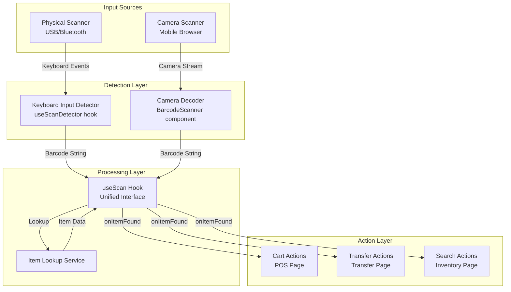

# Design Document: Barcode/QR Code Scanning Enhancement

## Overview

This feature enhances the POS system's barcode and QR code scanning capabilities to support both physical scanners (USB/Bluetooth devices) and camera-based scanning on mobile devices. The implementation focuses on:

1. **Physical Scanner Detection** - Detecting rapid keyboard input patterns from physical barcode scanners
2. **Camera Scanner Integration** - Proper permission handling and camera-based scanning for mobile devices
3. **Unified Scanning Hook** - A reusable React hook that handles both scanning methods
4. **Scannable Code Generation** - Ensuring generated barcodes/QR codes are valid and scannable
5. **Page-Specific Actions** - Callback-based architecture for different page behaviors

## Architecture



## Components and Interfaces

### 1. useScanDetector Hook

A custom React hook that detects physical scanner input by monitoring keyboard events for rapid input patterns.

```typescript
interface ScanDetectorOptions {
  onScan: (barcode: string) => void;
  minLength?: number;        // Minimum barcode length (default: 4)
  maxDelay?: number;         // Max ms between keystrokes (default: 50)
  endKeys?: string[];        // Keys that end scan (default: ['Enter'])
  enabled?: boolean;         // Enable/disable detection
}

interface ScanDetectorResult {
  isScanning: boolean;       // Currently receiving scan input
  lastScan: string | null;   // Last scanned barcode
  reset: () => void;         // Reset scan state
}

function useScanDetector(options: ScanDetectorOptions): ScanDetectorResult;
```

**Detection Algorithm:**
1. Listen for `keydown` events on the document
2. Track time between keystrokes
3. If keystrokes arrive faster than `maxDelay` (50ms), accumulate characters
4. When `Enter` is pressed and accumulated string length >= `minLength`, trigger `onScan`
5. Prevent default behavior to stop characters from appearing in input fields

### 2. BarcodeScanner Component (Enhanced)

The existing camera scanner component with improved permission handling.

```typescript
interface BarcodeScannerProps {
  isOpen: boolean;
  onClose: () => void;
  onScan: (result: string) => void;
  onError?: (error: Error) => void;
}
```

**Enhancements:**
- Clear permission request flow with user-friendly messages
- Fallback instructions for denied permissions
- Support for both barcode and QR code formats
- Improved error handling and recovery

### 3. useScan Hook

A unified hook that combines physical scanner detection and camera scanning with item lookup.

```typescript
interface UseScanOptions {
  onItemFound: (item: Item) => void;
  onItemNotFound?: (barcode: string) => void;
  onError?: (error: Error) => void;
  locationId?: string;       // For stock filtering
  enabled?: boolean;
}

interface UseScanResult {
  // Camera scanner controls
  showScanner: boolean;
  openScanner: () => void;
  closeScanner: () => void;
  
  // State
  isSearching: boolean;
  lastScannedBarcode: string | null;
  error: string | null;
  
  // Manual scan trigger
  handleScan: (barcode: string) => Promise<void>;
}

function useScan(options: UseScanOptions): UseScanResult;
```

### 4. Item Lookup API

Endpoint for looking up items by barcode or SKU.

```typescript
// GET /api/items/lookup?barcode={barcode}
interface ItemLookupResponse {
  success: boolean;
  data?: {
    item: Item;
    stocksByLocation: StockByLocation[];
    totalStock: number;
  };
  error?: {
    code: string;
    message: string;
  };
}
```

### 5. BarcodeGenerator Component (Enhanced)

The existing barcode generator with validation to ensure scannable output.

```typescript
interface BarcodeGeneratorProps {
  value: string;             // Barcode value to encode
  name?: string;             // Item name for labels
  price?: number;            // Item price for labels
  sku?: string;              // SKU for filename
}
```

**Validation:**
- Ensure barcode value contains only valid CODE128 characters
- Validate QR code data doesn't exceed size limits
- Test generated codes are scannable before display

## Data Models

### Scan Event

```typescript
interface ScanEvent {
  barcode: string;
  source: 'physical' | 'camera';
  timestamp: Date;
  page: string;
}
```

### Item with Stock (for scan results)

```typescript
interface ScannedItem {
  id: string;
  sku: string;
  name: string;
  barcode: string;
  unitPrice: number;
  costPrice: number;
  imageUrl?: string;
  stocksByLocation: {
    locationId: string;
    locationName: string;
    quantity: number;
    availableQuantity: number;
  }[];
  totalStock: number;
}
```

## Correctness Properties

*A property is a characteristic or behavior that should hold true across all valid executions of a system-essentially, a formal statement about what the system should do. Properties serve as the bridge between human-readable specifications and machine-verifiable correctness guarantees.*

### Property 1: Physical Scanner Detection Accuracy
*For any* sequence of characters entered faster than 50ms apart and ending with Enter key, the scan detector SHALL recognize it as a barcode scan and NOT as manual typing.
**Validates: Requirements 1.1**

### Property 2: Item Found Adds to Cart
*For any* valid barcode that matches an item in the database, scanning that barcode SHALL result in the item being added to the cart with quantity 1.
**Validates: Requirements 1.2, 2.5**

### Property 3: Existing Item Quantity Increment
*For any* cart containing an item, scanning that item's barcode SHALL increment the item's quantity by exactly 1.
**Validates: Requirements 1.3**

### Property 4: Unknown Barcode Error Handling
*For any* barcode string that does not match any item in the database, the system SHALL return an error state indicating item not found.
**Validates: Requirements 1.4**

### Property 5: Scanner Input Interception
*For any* detected physical scanner input, the scanned characters SHALL NOT appear in any focused input field on the page.
**Validates: Requirements 1.5**

### Property 6: Transfer Page Scan Search
*For any* barcode scanned on the transfer page, the system SHALL trigger a search query with that barcode value.
**Validates: Requirements 3.1**

### Property 7: Stock Availability Validation
*For any* item scanned for transfer, the system SHALL correctly report whether stock is available (> 0) or unavailable (= 0) at the source location.
**Validates: Requirements 3.2, 3.3**

### Property 8: Barcode Generation Validity
*For any* alphanumeric string of length 8-20 characters, the barcode generator SHALL produce a valid CODE128 barcode image.
**Validates: Requirements 4.1**

### Property 9: QR Code Generation Validity
*For any* string of length 1-100 characters, the QR code generator SHALL produce a valid QR code image.
**Validates: Requirements 4.2**

### Property 10: Barcode Round-Trip Consistency
*For any* valid barcode value, encoding it as a barcode image and then decoding that image SHALL return the original value.
**Validates: Requirements 4.3, 7.2**

### Property 11: QR Code Round-Trip Consistency
*For any* valid barcode value, encoding it as a QR code and then decoding that QR code SHALL return the original value.
**Validates: Requirements 4.4, 7.3**

### Property 12: Page-Specific Callback Execution
*For any* successful scan that finds an item, the page-specific callback (onItemFound) SHALL be invoked with the correct item data.
**Validates: Requirements 5.3**

## Error Handling

### Scanner Errors

| Error Code | Description | User Message |
|------------|-------------|--------------|
| SCAN_001 | Camera permission denied | "Camera access is required for scanning. Please enable camera permissions in your browser settings." |
| SCAN_002 | Camera not available | "No camera found. Please use a physical scanner or search manually." |
| SCAN_003 | Decode failed | "Could not read barcode. Please try again or enter manually." |
| SCAN_004 | Item not found | "Item not found. Please check the barcode and try again." |
| SCAN_005 | Network error | "Connection error. Please check your internet and try again." |

### Recovery Strategies

1. **Camera Permission Denied**: Show instructions for enabling permissions with browser-specific guidance
2. **Decode Failure**: Allow retry, suggest manual entry
3. **Item Not Found**: Show the scanned barcode value, allow manual search
4. **Network Error**: Retry with exponential backoff, cache last successful lookups

## Testing Strategy

### Unit Testing

Unit tests will verify individual component behavior:

1. **useScanDetector hook**
   - Detects rapid input as scan
   - Ignores slow typing
   - Handles various barcode lengths
   - Respects enabled/disabled state

2. **Item lookup service**
   - Returns correct item for valid barcode
   - Returns error for invalid barcode
   - Handles network errors gracefully

3. **Barcode/QR generation**
   - Generates valid CODE128 barcodes
   - Generates valid QR codes
   - Handles edge cases (special characters, max length)

### Property-Based Testing

Property-based tests will use **fast-check** library to verify correctness properties across many random inputs.

**Test Configuration:**
- Minimum 100 iterations per property test
- Custom generators for barcode strings, cart states, and item data

**Property Tests:**

1. **Scan Detection Property** - Generate random character sequences with timing, verify detection accuracy
2. **Cart Addition Property** - Generate random items and cart states, verify correct additions
3. **Quantity Increment Property** - Generate carts with items, verify increment behavior
4. **Round-Trip Properties** - Generate random barcode values, verify encode/decode consistency

Each property-based test will be tagged with the format:
`**Feature: barcode-qr-scanning-enhancement, Property {number}: {property_text}**`

### Integration Testing

1. **POS Page Integration** - Verify scan adds items to cart
2. **Transfer Page Integration** - Verify scan triggers search and stock check
3. **Cross-Browser Testing** - Verify camera permissions work on Chrome, Safari, Firefox mobile

## Implementation Notes

### Physical Scanner Detection

Physical barcode scanners typically:
- Send characters at 10-30ms intervals (much faster than human typing ~100-300ms)
- End with Enter key or configurable suffix
- May include prefix characters (configurable)

The detection algorithm uses a 50ms threshold to distinguish scanner input from typing.

### Camera Scanner Libraries

The existing implementation uses `@zxing/library` which supports:
- CODE128, CODE39, EAN-13, EAN-8, UPC-A, UPC-E barcodes
- QR codes, Data Matrix, Aztec codes

### Browser Compatibility

Camera scanning requires:
- HTTPS (or localhost for development)
- `getUserMedia` API support
- Camera hardware access

Supported browsers:
- Chrome 53+
- Safari 11+
- Firefox 36+
- Edge 12+
