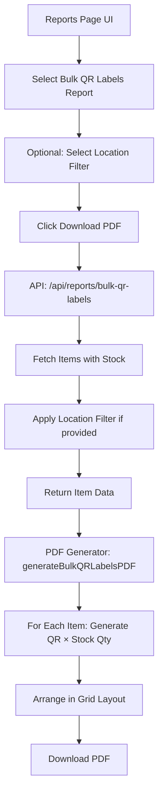

# Design Document: Bulk Item QR Code PDF

## Overview

This feature adds a new report type to the existing reports system that generates a PDF containing QR codes for all inventory items. The unique aspect is that each item's QR code is repeated based on its stock quantity, enabling stores to print labels for every physical unit in inventory.

The implementation follows the existing patterns in the codebase:
- API endpoint in `src/app/api/reports/bulk-qr-labels/route.ts`
- PDF generation function in `src/lib/pdf-generator.ts`
- UI integration in `src/app/(dashboard)/reports/page.tsx`

## Architecture



## Components and Interfaces

### 1. API Endpoint

**File:** `src/app/api/reports/bulk-qr-labels/route.ts`

```typescript
interface BulkQRReportParams {
  locationId?: string;  // Optional location filter
}

interface BulkQRReportItem {
  id: string;
  sku: string;
  name: string;
  barcode: string;
  unitPrice: number;
  stockQuantity: number;  // Total or location-specific
}

interface BulkQRReportResponse {
  success: boolean;
  data: {
    items: BulkQRReportItem[];
    totalLabels: number;
    locationName?: string;
    generatedAt: string;
  };
}
```

### 2. PDF Generator Function

**File:** `src/lib/pdf-generator.ts`

```typescript
interface BulkQRLabelData {
  items: BulkQRReportItem[];
  totalLabels: number;
  locationName?: string;
  generatedAt: string;
}

function generateBulkQRLabelsPDF(data: BulkQRLabelData): jsPDF
```

### 3. UI Integration

**File:** `src/app/(dashboard)/reports/page.tsx`

Add new report type to the `reportTypes` array with:
- id: 'bulk-qr-labels'
- name: 'Bulk QR Labels'
- description: 'QR codes for all items by quantity'
- icon: QrCode
- color: 'violet'
- permission: 'reports:inventory'

## Data Models

### Item Data for QR Generation

The system will query items with their stock information:

```typescript
// Query structure
const items = await prisma.item.findMany({
  where: { 
    isActive: true,
    stocks: locationId ? {
      some: { locationId, qty: { gt: 0 } }
    } : {
      some: { qty: { gt: 0 } }
    }
  },
  include: {
    stocks: locationId ? {
      where: { locationId }
    } : true
  }
});

// Transform to report format
const reportItems = items.map(item => ({
  id: item.id,
  sku: item.sku,
  name: item.name,
  barcode: item.barcode,
  unitPrice: item.unitPrice.toNumber(),
  stockQuantity: locationId 
    ? item.stocks[0]?.qty.toNumber() || 0
    : item.stocks.reduce((sum, s) => sum + s.qty.toNumber(), 0)
})).filter(item => item.stockQuantity > 0);
```

## Correctness Properties

*A property is a characteristic or behavior that should hold true across all valid executions of a system—essentially, a formal statement about what the system should do. Properties serve as the bridge between human-readable specifications and machine-verifiable correctness guarantees.*

### Property 1: QR Code Count Equals Stock Quantity

*For any* item with stock quantity N (where N > 0), the PDF generator SHALL produce exactly N QR code labels for that item. Items with zero stock SHALL produce zero labels.

**Validates: Requirements 1.3, 1.4**

### Property 2: QR Code Content Matches Barcode

*For any* generated QR code label, the encoded QR data SHALL exactly match the item's barcode value.

**Validates: Requirements 1.5**

### Property 3: Label Contains Required Information

*For any* generated label, the rendered output SHALL contain the item's name, SKU, and formatted price.

**Validates: Requirements 1.6**

### Property 4: Location Filter Restricts Items

*For any* report generated with a location filter, all included items SHALL have stock at that specific location, and the stock quantity used SHALL be the quantity at that location only.

**Validates: Requirements 3.2, 3.3**

### Property 5: No Location Filter Uses Total Stock

*For any* report generated without a location filter, the stock quantity used for each item SHALL equal the sum of stock quantities across all locations.

**Validates: Requirements 3.4**

### Property 6: Pagination Handles Large Quantities

*For any* set of items where the total label count exceeds one page capacity, the PDF SHALL contain multiple pages with all labels distributed across them.

**Validates: Requirements 2.3**

## Error Handling

| Error Scenario | Response Code | Error Code | Message |
|----------------|---------------|------------|---------|
| Unauthenticated request | 401 | AUTH_001 | Unauthorized |
| Missing permission | 403 | AUTH_002 | Forbidden |
| Invalid location ID | 400 | VAL_001 | Invalid location ID |
| No items with stock | 200 | - | Empty items array (valid response) |
| Database error | 500 | SRV_001 | Internal server error |

## Testing Strategy

### Unit Tests

1. **API Endpoint Tests**
   - Test authentication requirement
   - Test permission requirement
   - Test location filter parameter handling
   - Test response structure

2. **PDF Generator Tests**
   - Test label count matches stock quantity
   - Test QR code content encoding
   - Test label information display
   - Test pagination for large datasets

### Property-Based Tests

Using the existing test framework (Vitest), implement property-based tests for:

1. **QR Count Property**: Generate random items with random stock quantities, verify label count equals total stock
2. **Location Filter Property**: Generate items with stock at multiple locations, verify filtering works correctly
3. **Label Content Property**: Generate random item data, verify all required fields appear in output

### Test Configuration

- Minimum 100 iterations per property test
- Use fast-check for property-based testing
- Tag format: **Feature: bulk-item-qr-pdf, Property {number}: {property_text}**
