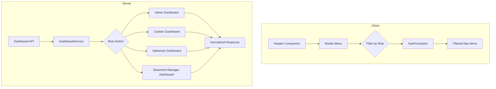

# Design Document: Dashboard Role Fixes

## Overview

This design addresses two critical issues in the Web POS system:
1. Mobile menu navigation showing all items regardless of user role
2. Dashboard displaying incorrect/empty data for non-admin users

The solution involves:
- Adding role-based filtering to the mobile menu in `header.tsx`
- Normalizing the dashboard API response structure in `dashboard.service.ts`
- Ensuring consistent field names across all role-specific dashboards

## Architecture

The fix follows the existing architecture patterns:
- Client-side permission checking using `hasPermission()` from `@/lib/permissions`
- Server-side data normalization in the dashboard service
- No changes to the database schema required



## Components and Interfaces

### 1. Header Component Changes (`src/components/layout/header.tsx`)

Add role-based filtering to the mobile menu using the same logic as the sidebar:

```typescript
// Add imports
import { useSession } from 'next-auth/react';
import { hasPermission } from '@/lib/permissions';

// Add filtering logic inside Header component
const { data: session } = useSession();

const filteredMobileNavItems = useMemo(() => {
  if (!session?.user) return [];
  const role = session.user.role;

  return mobileNavItems.filter((item) => {
    switch (item.name) {
      case 'Dashboard': return true;
      case 'POS': return hasPermission(role, 'sales:write');
      case 'Inventory': return hasPermission(role, 'items:read');
      case 'Customers': return hasPermission(role, 'customers:read');
      case 'Layaways': return true;
      case 'Credits': return hasPermission(role, 'credits:read');
      case 'Transfers': return hasPermission(role, 'transfers:read');
      case 'Expenses': return hasPermission(role, 'expenses:read');
      case 'Money': return hasPermission(role, 'finance:read');
      case 'Bank Accounts': return hasPermission(role, 'bank-accounts:read');
      case 'Sessions': return hasPermission(role, 'sessions:read');
      case 'Defects': return hasPermission(role, 'defects:read');
      case 'Vendors': return hasPermission(role, 'vendors:read');
      case 'Reports': return hasPermission(role, 'reports:view');
      case 'Settings': return hasPermission(role, 'settings:read');
      default: return true;
    }
  });
}, [session]);
```

### 2. Dashboard Service Changes (`src/services/dashboard.service.ts`)

Normalize the response structure for Cashier and Salesman dashboards:

```typescript
// Modify getCashierDashboard to return normalized fields
static async getCashierDashboard(userId: string, locationId: string): Promise<CashierDashboard & NormalizedDashboard> {
  // ... existing code ...
  
  return {
    // Existing fields
    locationSales: { ... },
    recentSales: [...],
    // ... other fields ...
    
    // Normalized fields for frontend consistency
    totalSales: {
      today: Number(locationSalesData._sum.totalAmount || 0),
      week: 0,
      month: 0,
    },
    recentTransactions: recentSales.map((s) => ({
      id: s.id,
      receiptNumber: s.receiptNumber,
      totalAmount: Number(s.totalAmount),
      status: 'COMPLETED',
      createdAt: s.createdAt,
      items: s.items.map((i) => ({ name: i.item.name, qty: Number(i.qty) })),
      payments: s.payments.map((p) => ({
        method: p.method,
        amount: Number(p.amount),
        bankName: p.bankAccount?.bankName || null,
      })),
    })),
  };
}

// Similar changes for getSalesmanDashboard
```

### 3. Normalized Dashboard Interface

```typescript
interface NormalizedDashboard {
  totalSales: { today: number; week: number; month: number };
  recentTransactions: Array<{
    id: string;
    receiptNumber: string;
    totalAmount: number;
    status: string;
    createdAt: Date;
    items: Array<{ name: string; qty: number }>;
    payments: Array<{ method: string; amount: number; bankName: string | null }>;
  }>;
}
```

## Data Models

No changes to database models required. The fix is purely in the service layer data transformation.

## Correctness Properties

*A property is a characteristic or behavior that should hold true across all valid executions of a system—essentially, a formal statement about what the system should do. Properties serve as the bridge between human-readable specifications and machine-verifiable correctness guarantees.*

### Property 1: Mobile Menu Filtering Consistency

*For any* user role, the mobile menu navigation items SHALL be identical to the desktop sidebar navigation items for that same role.

**Validates: Requirements 1.1, 1.5**

### Property 2: API Response Structure Consistency

*For any* role with sales data (ADMIN, CASHIER, SALESMAN), the dashboard API response SHALL contain both `totalSales.today` and `recentTransactions` fields with valid data.

**Validates: Requirements 3.1, 3.2**

### Property 3: Sales Total Accuracy

*For any* dashboard API response, the `totalSales.today` value SHALL equal the sum of completed sales amounts for the current session for that user's scope (all sales for ADMIN, location sales for CASHIER, personal sales for SALESMAN).

**Validates: Requirements 2.2, 2.4**

## Error Handling

- If user session is not available, mobile menu returns empty array (no navigation items)
- If no active session exists, dashboard returns zero values for sales metrics
- If location ID is missing for CASHIER, dashboard returns empty sales data

## Testing Strategy

### Unit Tests
- Test `hasPermission` function with various role/permission combinations
- Test navigation filtering logic for each role
- Test data normalization in dashboard service

### Property-Based Tests
- Use fast-check to generate random roles and verify filtering consistency
- Verify API response structure contains required fields for all applicable roles

### Integration Tests
- Test dashboard API endpoint returns correct structure for each role
- Test mobile menu renders correct items for each role

### Test Framework
- Use Vitest for unit and property-based tests
- Use fast-check for property-based testing
- Minimum 100 iterations per property test
