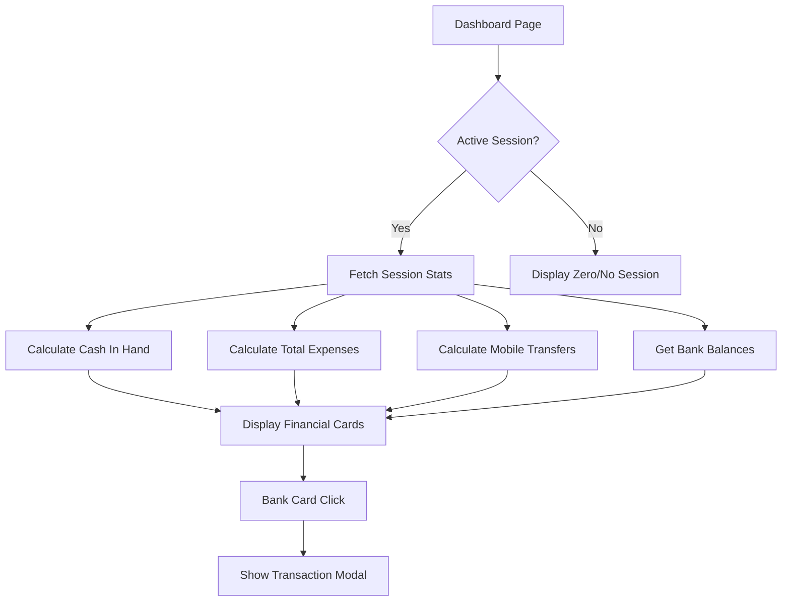

# Design Document: Dashboard Session Financials

## Overview

This feature enhances the Admin and Cashier dashboards to display accurate, real-time session-based financial information. The system will calculate and display total cash in hand, total expenses, and total mobile/bank transfers for the current active session only. When no session is active or when a session is closed, all financial metrics reset to zero to ensure clean daily tracking.

The implementation focuses on data accuracy and correctness, as this is a real business application where financial discrepancies can cause significant problems.

## Architecture

### High-Level Flow



### Data Flow

```mermaid
sequenceDiagram
    participant UI as Dashboard UI
    participant API as Dashboard API
    participant Service as DashboardService
    participant DB as Database
    
    UI->>API: GET /api/dashboard
    API->>Service: getSessionFinancials()
    Service->>DB: Get active session
    alt No Active Session
        Service-->>API: Return zeros
    else Active Session
        Service->>DB: Query cash transactions
        Service->>DB: Query expenses
        Service->>DB: Query mobile transfers
        Service->>DB: Query bank accounts
        Service-->>API: Return calculated metrics
    end
    API-->>UI: Financial data
    UI->>UI: Render cards
    
    UI->>API: GET /api/bank-accounts/{id}/transactions
    API->>DB: Get session transactions
    API-->>UI: Transaction list
    UI->>UI: Show modal
```



## Components and Interfaces

### 1. DashboardService Enhancement

```typescript
interface SessionFinancials {
  hasActiveSession: boolean;
  sessionId: string | null;
  sessionStartTime: Date | null;
  
  cashInHand: number;
  totalExpenses: number;
  totalMobileTransfers: number;
  
  bankAccounts: BankAccountSummary[];
}

interface BankAccountSummary {
  id: string;
  bankName: string;
  accountNumber: string;
  currentBalance: number;
  sessionTransactionCount: number;
  sessionInflow: number;
  sessionOutflow: number;
}

interface CashInHandBreakdown {
  openingBalance: number;
  cashSales: number;
  cashLayawayPayments: number;
  cashCreditPayments: number;
  specialIncome: number;
  cashExpenses: number;
  cashToBank: number;
  bankToCash: number;
  total: number;
}
```

### 2. New API Endpoint

```typescript
// GET /api/dashboard/session-financials
interface SessionFinancialsResponse {
  success: boolean;
  data: SessionFinancials;
}

// GET /api/bank-accounts/{id}/session-transactions
interface BankTransactionsResponse {
  success: boolean;
  data: {
    transactions: BankTransaction[];
    summary: {
      totalInflow: number;
      totalOutflow: number;
      transactionCount: number;
    };
  };
}
```

### 3. Dashboard UI Components

```typescript
// New financial cards for dashboard
interface FinancialCardProps {
  title: string;
  amount: number;
  icon: React.ReactNode;
  onClick?: () => void;
  breakdown?: Record<string, number>;
}

// Bank account transaction modal
interface BankTransactionModalProps {
  bankAccountId: string;
  bankName: string;
  isOpen: boolean;
  onClose: () => void;
}
```

## Data Models

### Existing Models Used

- `DailySession`: Tracks session state, opening/closing times, opening balance
- `Sale` + `Payment`: Sales with payment methods (CASH, MOBILE_TRANSFER, CREDIT)
- `Expense`: Expenses with payment method and session linkage
- `CreditPayment`: Credit payments with payment method
- `LayawayPayment`: Layaway payments with payment method
- `SpecialIncome`: Additional income entries
- `FundTransfer`: Cash-to-bank and bank-to-cash transfers
- `BankAccount` + `BankTransaction`: Bank account balances and transaction history

### Cash In Hand Calculation Formula

```
Cash In Hand = Opening Balance
             + Cash Sales (payments where method = 'CASH')
             + Cash Layaway Payments (where paymentMethod = 'CASH')
             + Cash Credit Payments (where paymentMethod = 'CASH')
             + Special Income (cash-based)
             + Bank to Cash Transfers
             - Cash Expenses (where paymentMethod = 'CASH')
             - Cash to Bank Transfers
```

## Correctness Properties

*A property is a characteristic or behavior that should hold true across all valid executions of a system-essentially, a formal statement about what the system should do. Properties serve as the bridge between human-readable specifications and machine-verifiable correctness guarantees.*

### Property 1: Cash in hand calculation correctness
*For any* active session with any combination of cash transactions (sales, layaway payments, credit payments, special income, expenses, fund transfers), the calculated cash in hand SHALL equal: Opening Balance + Cash Inflows - Cash Outflows, where Cash Inflows = Cash Sales + Cash Layaway Payments + Cash Credit Payments + Special Income + Bank-to-Cash Transfers, and Cash Outflows = Cash Expenses + Cash-to-Bank Transfers.
**Validates: Requirements 1.1, 5.1**

### Property 2: No active session returns zeros
*For any* dashboard request when no session is active (status != 'OPEN'), all financial metrics (cash in hand, total expenses, total mobile transfers) SHALL be zero.
**Validates: Requirements 1.2, 2.2, 3.3**

### Property 3: Session close resets all metrics
*For any* session that transitions from OPEN to CLOSED status, immediately after closing, all dashboard financial metrics SHALL display zero or "No Active Session".
**Validates: Requirements 1.3, 2.3, 4.4**

### Property 4: Session-scoped data filtering
*For any* active session, all financial data (sales, expenses, payments) displayed on the dashboard SHALL only include records created after the session's openedAt timestamp and linked to the current session where applicable.
**Validates: Requirements 4.1, 4.2, 4.3**

### Property 5: Mobile transfer calculation correctness
*For any* active session, the total mobile transfers SHALL equal the sum of all Payment records where method = 'MOBILE_TRANSFER' and the associated sale was created within the session timeframe.
**Validates: Requirements 3.1, 5.2**

### Property 6: Bank account session transactions
*For any* bank account and active session, the transaction list SHALL only include transactions created within the session timeframe, and the session transaction count SHALL equal the length of this filtered list.
**Validates: Requirements 3.2, 5.3**

### Property 7: Expense session filtering
*For any* active session, the total expenses displayed SHALL equal the sum of all Expense records where sessionId matches the current session ID and paymentMethod = 'CASH'.
**Validates: Requirements 2.1**

## Error Handling

### Session State Errors
- **No Active Session**: Return `hasActiveSession: false` with all metrics as zero
- **Multiple Open Sessions**: Log error, use most recent session (should not happen in normal operation)

### Data Integrity Errors
- **Missing Session Link**: Expenses/sales without sessionId are excluded from session totals
- **Invalid Payment Method**: Unknown payment methods are logged and excluded from calculations
- **Decimal Precision**: All monetary calculations use Decimal type with 2 decimal places

### API Error Responses
```typescript
interface ErrorResponse {
  success: false;
  error: {
    code: string;
    message: string;
    timestamp: string;
    requestId: string;
  };
}
```

Error Codes:
- `SESSION_001`: No active session found
- `CALC_001`: Cash calculation error
- `DATA_001`: Data integrity issue detected

## Testing Strategy

### Property-Based Testing Library
- **Library**: fast-check (TypeScript property-based testing)
- **Minimum Iterations**: 100 per property test

### Unit Tests
- Test individual calculation functions with known inputs
- Test edge cases: empty session, single transaction, maximum values
- Test session state transitions

### Property-Based Tests
Each correctness property will have a corresponding property-based test:

1. **Cash Calculation Property Test**: Generate random combinations of cash transactions and verify formula
2. **No Session Zero Property Test**: Verify all metrics return zero when no session exists
3. **Session Close Reset Property Test**: Verify metrics reset after session close
4. **Session Filtering Property Test**: Verify only session-scoped data is included
5. **Mobile Transfer Property Test**: Verify mobile transfer sum calculation
6. **Bank Transaction Property Test**: Verify bank transaction filtering by session
7. **Expense Filtering Property Test**: Verify expense session filtering

### Test Annotation Format
Each property-based test MUST include:
```typescript
/**
 * **Feature: dashboard-session-financials, Property 1: Cash in hand calculation correctness**
 * **Validates: Requirements 1.1, 5.1**
 */
```

### Integration Tests
- Test full API flow from request to response
- Test dashboard UI rendering with mock data
- Test bank transaction modal interaction
