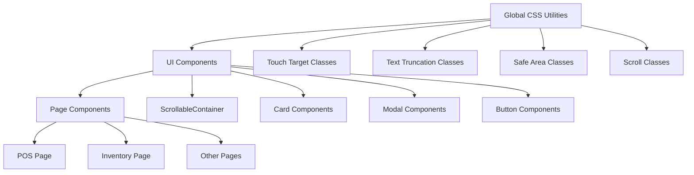

# Design Document: Mobile UI Fixes

## Overview

This design addresses mobile UI issues across the entire Web POS application. The solution focuses on CSS improvements, component updates, and ensuring consistent mobile-first patterns throughout the app. Key areas include touch target sizing, text truncation, modal accessibility, bottom navigation spacing, scroll behavior, barcode generator responsiveness, smart currency formatting, inventory action button overflow, form field visibility, settings page responsiveness, report page date visibility, and overall text size optimization for small screens.

## Architecture

The implementation follows a layered approach:



### Key Improvements

1. **Touch Target Enforcement**: Ensure all interactive elements meet 44x44px minimum
2. **Text Handling**: Consistent truncation and line clamping across cards
3. **Modal Scrollability**: All modals properly scroll on mobile
4. **Bottom Spacing**: Consistent padding to avoid bottom nav overlap
5. **Scroll Indicators**: Visual feedback for scrollable content
6. **Barcode Generator Responsiveness**: Format toggle and print buttons fully visible on mobile
7. **Smart Currency Formatting**: Remove unnecessary .00 decimals from whole numbers
8. **Inventory Action Buttons**: Prevent overflow and keep buttons within card bounds
9. **Form Field Visibility**: SKU and price inputs fully visible on mobile
10. **Settings Page Responsiveness**: Smaller text, truncation, and single column layout on very small screens
11. **Report Page Date Visibility**: Full date values visible with responsive text sizing
12. **Global Text Optimization**: Responsive text sizes throughout the application for small screens

## Components and Interfaces

### Enhanced CSS Utilities

New and updated utility classes in `globals.css`:

```css
/* Touch target minimum - already exists, ensure consistent usage */
.touch-target-min {
  min-height: 44px;
  min-width: 44px;
}

/* Safe area utilities - already exist, ensure consistent usage */
.safe-bottom { padding-bottom: env(safe-area-inset-bottom, 0); }

/* Text truncation - already exists */
.truncate { overflow: hidden; text-overflow: ellipsis; white-space: nowrap; }

/* Line clamping */
.line-clamp-2 {
  display: -webkit-box;
  -webkit-line-clamp: 2;
  -webkit-box-orient: vertical;
  overflow: hidden;
}
```

### Component Updates

#### PaymentModal Improvements
- Stack credit customer fields vertically on mobile
- Ensure Complete Sale button is in sticky footer
- Add proper scroll handling for long content

#### POS Page Cart
- Fix cart height constraints on mobile
- Ensure checkout button visibility
- Improve cart handle display

#### List Pages (Inventory, Customers, etc.)
- Consistent bottom padding (pb-20 md:pb-6)
- Proper FAB positioning
- Card-based layouts on mobile

#### BarcodeGenerator Component Updates
- Make format toggle buttons responsive with `flex-wrap` and proper sizing
- Stack print/download buttons vertically on very small screens
- Ensure quantity controls fit within viewport width
- Add responsive classes for mobile-first layout

#### Smart Currency Formatting
- Create `formatCurrencySmart()` utility function
- Remove trailing `.00` for whole numbers
- Keep decimals for amounts with cents
- Apply to dashboard financial metrics

#### Inventory Page Action Buttons
- Use `flex-wrap` on action button containers
- Reduce icon button sizes on mobile while maintaining 44px touch targets
- Consider dropdown menu for very small screens
- Ensure buttons stay within card boundaries

#### Inventory New/Edit Form
- Stack SKU input and action buttons vertically on mobile
- Ensure price inputs (cost, selling) are full width on small screens
- Make generated SKU fully visible in input field

#### Settings Page Updates
- Use responsive text sizes: `text-sm sm:text-base` for card titles
- Truncate descriptions with `truncate` class on small screens
- Use `grid-cols-1 sm:grid-cols-2 lg:grid-cols-3` for responsive grid
- Reduce icon container size on mobile: `h-10 w-10 sm:h-12 sm:w-12`
- Stack card content vertically on very small screens with `flex-col xs:flex-row`

#### Reports Page Updates
- Use responsive text for date labels: `text-xs`
- Ensure date inputs have `w-full` and proper sizing
- Use smaller button text on mobile: `text-xs sm:text-sm`
- Report type selector buttons use responsive padding and text
- Add `min-w-0` to prevent text overflow in buttons

#### Global Text Size Optimization
- Page headers: `text-xl sm:text-2xl` for h1 elements
- Card titles: `text-sm sm:text-base` for CardTitle components
- Form labels: `text-xs` consistently on mobile
- Navigation items: `text-sm` with proper truncation
- Add responsive text utility classes to globals.css

### New CSS Utilities

```css
/* Responsive text utilities */
.text-responsive-xs {
  @apply text-[10px] sm:text-xs;
}

.text-responsive-sm {
  @apply text-xs sm:text-sm;
}

.text-responsive-base {
  @apply text-sm sm:text-base;
}

.text-responsive-lg {
  @apply text-base sm:text-lg;
}

.text-responsive-xl {
  @apply text-lg sm:text-xl;
}

.text-responsive-2xl {
  @apply text-xl sm:text-2xl;
}
```

## Data Models

No new data models required. This feature is purely UI/UX focused.

## Correctness Properties

*A property is a characteristic or behavior that should hold true across all valid executions of a system-essentially, a formal statement about what the system should do. Properties serve as the bridge between human-readable specifications and machine-verifiable correctness guarantees.*

### Property 1: Touch targets meet minimum size
*For any* interactive element (button, link, input) rendered in the application, the element SHALL have computed dimensions of at least 44x44 pixels.
**Validates: Requirements 1.1, 1.3, 6.2, 6.4**

### Property 2: Product names truncate properly
*For any* product card displaying a product name, the name element SHALL have CSS properties that enable truncation (overflow: hidden, text-overflow: ellipsis) rather than allowing overflow.
**Validates: Requirements 2.1, 2.4**

### Property 3: Prices remain fully visible
*For any* price display element, the element SHALL NOT have text-overflow: ellipsis applied and the content SHALL be fully visible (scrollWidth equals clientWidth).
**Validates: Requirements 2.2**

### Property 4: Modals are scrollable on mobile
*For any* modal component, the modal content container SHALL have overflow-y set to auto or scroll, and SHALL have a max-height constraint that allows scrolling when content exceeds viewport.
**Validates: Requirements 3.1**

### Property 5: Bottom spacing prevents nav overlap
*For any* page with a bottom navigation, the main content area SHALL have bottom padding of at least 80px (pb-20) on mobile viewports to prevent content overlap.
**Validates: Requirements 4.1, 4.2, 4.3**

### Property 6: Scrollable containers have momentum scrolling
*For any* scrollable container, the container SHALL have -webkit-overflow-scrolling: touch or equivalent smooth scroll behavior enabled.
**Validates: Requirements 5.1, 5.3**

### Property 7: Scroll indicators appear when content overflows
*For any* ScrollableContainer component where scrollHeight exceeds clientHeight, the component SHALL display visual scroll indicators.
**Validates: Requirements 5.2**

### Property 8: Consistent mobile card layouts
*For any* list page on mobile viewport, the page SHALL use card-based layouts with the mobile-card class applied consistently.
**Validates: Requirements 8.1, 8.2**

### Property 9: Barcode generator controls are fully visible
*For any* BarcodeGenerator component rendered on mobile viewport, all controls (format toggle, print button, download button, quantity controls) SHALL have no horizontal overflow (scrollWidth equals clientWidth).
**Validates: Requirements 9.1, 9.3, 9.4**

### Property 10: Smart currency formatting removes unnecessary decimals
*For any* whole number currency amount, the formatCurrencySmart function SHALL return a string without ".00" suffix. *For any* non-whole number amount, the function SHALL include the decimal portion.
**Validates: Requirements 10.1, 10.2**

### Property 11: Inventory action buttons fit within container
*For any* inventory item card or row on mobile viewport, the action button container SHALL have no horizontal overflow and all buttons SHALL remain within the card boundaries.
**Validates: Requirements 11.1, 11.2, 11.3**

### Property 12: Form inputs show complete values
*For any* SKU input field or price input field on mobile viewport, the input SHALL display the complete value without truncation (scrollWidth equals clientWidth for the input content).
**Validates: Requirements 12.1, 13.1, 13.3**

### Property 13: Settings cards have responsive text
*For any* settings navigation card on small screens, the card title and description text SHALL have font sizes that fit within the card boundaries without overflow.
**Validates: Requirements 14.1, 14.2**

### Property 14: Settings grid uses single column on small screens
*For any* settings page rendered on very small screens (< 640px), the grid layout SHALL display cards in a single column.
**Validates: Requirements 14.4**

### Property 15: Report date inputs are fully visible
*For any* date input field on the reports page rendered on small screens, the input SHALL display the complete date value without truncation.
**Validates: Requirements 15.1**

### Property 16: Report buttons have responsive text
*For any* button in the reports page (date picker buttons, report type selector) on small screens, the button text SHALL fit within the button boundaries without overflow.
**Validates: Requirements 15.3, 15.4**

### Property 17: Page headers use responsive text sizes
*For any* page header (h1) on small screens, the font size SHALL be smaller than on desktop viewports (responsive sizing applied).
**Validates: Requirements 16.1**

### Property 18: Card titles use responsive text sizes
*For any* card title on small screens, the font size SHALL be appropriate for the screen width without causing overflow.
**Validates: Requirements 16.2**

## Error Handling

| Scenario | Handling |
|----------|----------|
| CSS class not applied | Fallback to default browser styles |
| Scroll indicator fails | Gracefully degrade - content remains scrollable |
| Touch target too small | Log warning in development mode |

## Testing Strategy

### Dual Testing Approach

This feature uses both unit tests and property-based tests:

- **Unit tests**: Verify specific UI states, component rendering, and edge cases
- **Property-based tests**: Verify CSS properties hold across many elements

### Property-Based Testing

**Library**: `fast-check` with `@testing-library/react`

Each property-based test will:
- Run a minimum of 100 iterations
- Generate random component states and viewport sizes
- Verify the property holds for all generated inputs
- Be tagged with the format: `**Feature: mobile-ui-fixes, Property {number}: {property_text}**`

### Unit Testing

Unit tests will cover:
- Touch target dimensions on buttons and inputs
- Text truncation on product cards
- Modal scroll behavior
- Bottom padding on pages
- ScrollableContainer indicator visibility
- BarcodeGenerator responsive layout
- formatCurrencySmart function behavior
- Inventory action button overflow
- Form input visibility
- Settings page responsive layout
- Reports page date input visibility
- Global responsive text sizing

### Test Files

```
src/__tests__/components/
  mobile-ui.test.tsx           # Property tests for mobile UI
  payment-modal.test.tsx       # Unit tests for payment modal
  pos-page.test.tsx            # Unit tests for POS page mobile
  barcode-generator.test.tsx   # Unit tests for barcode generator
  settings-page.test.tsx       # Unit tests for settings page responsiveness
  reports-page.test.tsx        # Unit tests for reports page responsiveness
src/__tests__/lib/
  utils.test.ts                # Tests for formatCurrencySmart
```

