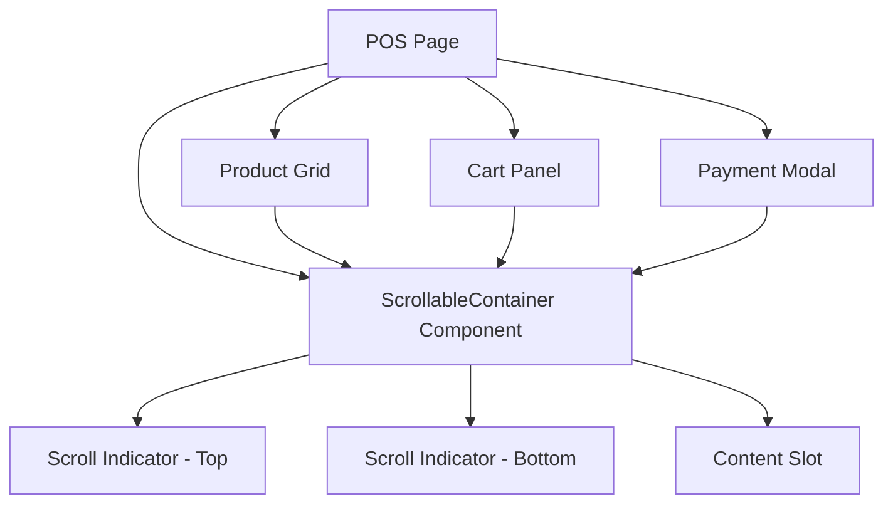

# Design Document: POS Mobile Responsiveness

## Overview

This design addresses mobile responsiveness issues in the POS page by implementing scroll indicators, optimizing touch targets, and ensuring all UI elements are accessible on small screens. The solution focuses on CSS-based improvements and a reusable scroll indicator component that provides visual feedback when content is scrollable.

## Architecture

The implementation follows a component-based approach with minimal changes to existing logic:



### Key Components

1. **ScrollableContainer**: A wrapper component that detects overflow and displays scroll indicators
2. **Enhanced CSS Classes**: New utility classes for mobile-optimized layouts
3. **Updated POS Page**: Refactored to use ScrollableContainer and improved responsive styles
4. **Updated Payment Modal**: Improved layout for mobile credit payment fields

## Components and Interfaces

### ScrollableContainer Component

```typescript
interface ScrollableContainerProps {
  children: React.ReactNode;
  className?: string;
  showIndicators?: boolean;
  maxHeight?: string;
}

interface ScrollState {
  canScrollUp: boolean;
  canScrollDown: boolean;
}
```

**Responsibilities:**
- Detect when content overflows the container
- Track scroll position to show/hide indicators
- Render gradient fade indicators at top/bottom when scrollable
- Apply momentum scrolling for touch devices

### Enhanced Mobile Styles

New CSS classes to be added to `globals.css`:

```css
.scroll-container       /* Base scrollable container */
.scroll-indicator-top   /* Top fade gradient */
.scroll-indicator-bottom /* Bottom fade gradient */
.touch-scroll           /* Momentum scrolling */
.mobile-grid-2col       /* 2-column grid for mobile */
```

## Data Models

No new data models required. This feature is purely UI/UX focused.

## Correctness Properties

*A property is a characteristic or behavior that should hold true across all valid executions of a system-essentially, a formal statement about what the system should do. Properties serve as the bridge between human-readable specifications and machine-verifiable correctness guarantees.*

### Property 1: Scroll indicator visibility reflects scroll state
*For any* scrollable container with overflow content, the bottom scroll indicator SHALL be visible when scrollTop is less than (scrollHeight - clientHeight), and the top scroll indicator SHALL be visible when scrollTop is greater than 0.
**Validates: Requirements 1.1, 1.2, 1.3, 2.2, 3.2**

### Property 2: No scroll indicators when content fits
*For any* scrollable container where scrollHeight equals clientHeight, both top and bottom scroll indicators SHALL be hidden.
**Validates: Requirements 1.4**

### Property 3: Touch targets meet minimum size
*For any* interactive element (button, input, clickable card) within the POS page on mobile viewports, the element SHALL have minimum dimensions of 44x44 pixels.
**Validates: Requirements 2.3**

### Property 4: Product names truncate with ellipsis
*For any* product card in the Product_Grid, the product name element SHALL have CSS properties `overflow: hidden`, `text-overflow: ellipsis`, and `white-space: nowrap` or equivalent truncation behavior.
**Validates: Requirements 4.2**

### Property 5: Prices remain fully visible
*For any* product card in the Product_Grid, the price element SHALL NOT have `text-overflow: ellipsis` applied and SHALL be fully visible without truncation.
**Validates: Requirements 4.3**

### Property 6: Momentum scrolling enabled on touch devices
*For any* scrollable container, the CSS SHALL include `-webkit-overflow-scrolling: touch` or equivalent smooth scroll behavior for touch devices.
**Validates: Requirements 5.1**

## Error Handling

| Scenario | Handling |
|----------|----------|
| Scroll event listener fails to attach | Gracefully degrade - hide indicators, maintain scrollability |
| ResizeObserver not supported | Fall back to window resize event |
| Touch events not supported | Standard mouse scroll behavior applies |

## Testing Strategy

### Dual Testing Approach

This feature uses both unit tests and property-based tests:

- **Unit tests**: Verify specific UI states and edge cases
- **Property-based tests**: Verify scroll indicator behavior across many scroll positions

### Property-Based Testing

**Library**: `fast-check` with `@testing-library/react`

Each property-based test will:
- Run a minimum of 100 iterations
- Generate random scroll positions and container sizes
- Verify the property holds for all generated inputs
- Be tagged with the format: `**Feature: pos-mobile-responsiveness, Property {number}: {property_text}**`

### Unit Testing

Unit tests will cover:
- ScrollableContainer renders correctly with/without overflow
- Scroll indicators appear/disappear on scroll events
- Touch target sizes meet minimum requirements
- Product card truncation behavior
- Payment modal layout on mobile viewports

### Test Files

```
src/__tests__/components/
  scrollable-container.test.tsx    # Unit + property tests for ScrollableContainer
  pos-page-mobile.test.tsx         # Unit tests for POS page mobile layout
  payment-modal-mobile.test.tsx    # Unit tests for payment modal mobile layout
```
